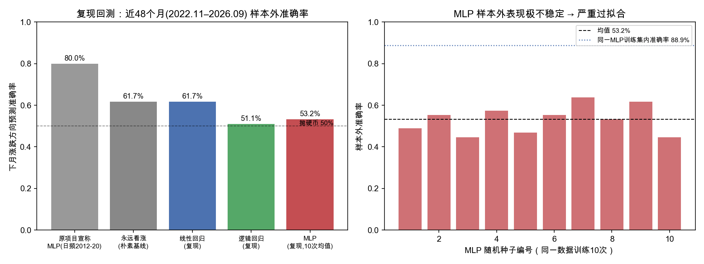
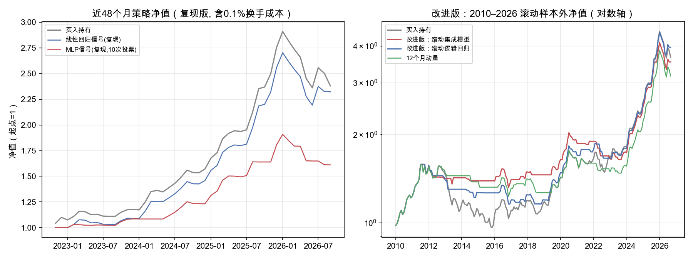
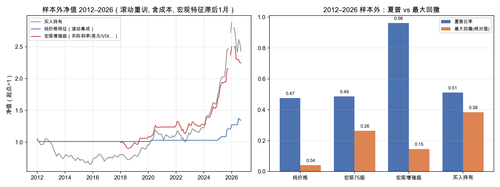

# 黄金价格预测方法的开源复现与改进（Gold Signal Quant）

> 对一个流行的"线性回归 + MLP 预测黄金价格"开源方法进行**严格样本外回测**，
> 证明其宣称的 80% 准确率不可复现，并给出一个**可实盘参考的宏观增强改进版**（月度多空信号）。

灵感与基线来自 [SHUAIBAO-AI/Predict-Gold-Future-Price-Quant](https://github.com/SHUAIBAO-AI/Predict-Gold-Future-Price-Quant)
（线性回归 25% / MLP 80% 预测金价涨跌）。本项目用更新到 2026 年的数据重新检验了它，并修复了其方法论问题。

## 核心结论

1. **原方法的 80% 准确率站不住脚**：在最近 48 个月（2022.11–2026.09）的严格样本外回测中，
   复现的 MLP 方向准确率仅 **53.2%**（10 次随机种子在 44.7%–63.8% 间剧烈波动），
   同一模型训练集内准确率 88.9% —— 典型过拟合。同期"永远看涨"朴素基线都有 61.7%。
2. **改进方向不是更复杂的模型，而是更诚实的评估 + 更好的特征 + 风险管理**：
   滚动重训、宏观特征滞后防前视偏差、概率阈值仓位、含交易成本的策略评估。
3. **宏观+资金情绪增强版（实际利率/CPI/失业率/VIX/美元指数/CFTC 持仓 + 价格动量）在 2012–2026 样本外**：
   夏普比率 **1.00**（买入持有 0.51），最大回撤 **-14.6%**（买入持有 -38.4%），
   方向准确率 57.3%（近 48 个月 64.4%）。价值在于**回撤控制与风险调整后收益**，而非"神准预测"。





## 回测结果摘要

### 复现版（近 48 个月样本外，纯价格特征）

| 模型 | 方向准确率 | 备注 |
|---|---|---|
| 原项目宣称（MLP） | 80% | 无法在样本外复现 |
| 永远看涨（朴素基线） | 61.7% | 大牛市基准 |
| 线性回归（复现） | 61.7% | 退化为几乎月月看涨 |
| 逻辑回归（复现） | 51.1% | ≈ 抛硬币 |
| MLP（复现，10 次均值） | 53.2% | 训练集内 88.9% → 过拟合 |

### 宏观增强版（2012–2026 滚动样本外，含 0.1% 换手成本）

| 策略 | 年化收益 | 最大回撤 | 夏普比率 | 方向准确率 |
|---|---|---|---|---|
| 纯价格特征（滚动集成） | 2.0% | -4.1% | 0.47 | 54.2% |
| 宏观基础版（利率/CPI/失业率） | 5.0% | -26.4% | 0.49 | 50.9% |
| 宏观增强版（+VIX/美元指数） | 9.9% | -14.6% | 0.96 | 56.3% |
| **+资金情绪（CFTC 非商业持仓，当前生产模型）** | **10.2%** | **-14.6%** | **1.00** | **57.3%** |
| 买入持有 | 6.3% | -38.4% | 0.51 | — |

最近 48 个月（2022.11–2026.09）：宏观+持仓版夏普 **1.67**、方向准确率 **64.4%**
（宏观版 1.56 / 57.8%，买入持有 1.79 / —）。

### 仓位管理（在宏观+持仓模型之上，同一回测协议）

信号不只回答"看多/观望"，还输出 0–100% 建议仓位：
**仓位 = 概率强度 clip((P−0.5)/0.15, 0, 1) × 波动率系数 min(1, 12%/年化已实现波动)**。

| 仓位规则 | 夏普（2012–2026） | 最大回撤 | 夏普（近48月） | 回撤（近48月） | 平均仓位 |
|---|---|---|---|---|---|
| 0/1 开关 | 1.00 | -14.6% | 1.67 | -10.2% | 62% |
| 概率强度 | 1.06 | -13.9% | 1.88 | -7.2% | 49% |
| **概率 × 波动率目标（当前生产）** | **1.12** | **-13.9%** | **2.06** | **-4.6%** | 47% |

## 数据

| 数据 | 来源 | 频率 | 范围 |
|---|---|---|---|
| 黄金价格 | [datahub.io/core/gold-prices](https://datahub.io/core/gold-prices)（Timothy Green 历史记录 + 世界银行 Pink Sheet） | 月 | 1833 至今 |
| 10 年期美债收益率 DGS10 | FRED 免密钥接口 | 日→月均 | 1970 至今 |
| CPI（CPIAUCSL） | FRED | 月 | 1970 至今 |
| 失业率（UNRATE） | FRED | 月 | 1970 至今 |
| VIX（VIXCLS） | FRED | 日→月均 | 1990 至今 |
| 广义美元指数（DTWEXBGS） | FRED | 日→月均 | 2006 至今 |
| COMEX 黄金非商业持仓（COT） | CFTC 年度公开文件 | 周→月末 | 2006 至今 |

**无前视偏差设计**：所有宏观特征滞后 1 个月使用（模拟真实发布延迟：CPI 次月中旬公布、
非农次月第一个周五公布）；归一化仅在训练集上拟合；评估采用扩张窗口逐年滚动重训。

## 快速开始

```bash
pip install -r requirements.txt

# 生成最新的月度多空信号（自动在线更新全部数据）
python src/monthly_signal.py

# 复现回测（从项目根目录运行）
python src/backtest_replica.py    # 复现原项目方法（近48个月样本外）
python src/backtest_improved.py   # 改进版：滚动重训 + 概率阈值
python src/backtest_macro.py      # 宏观增强版
python src/make_figs.py && python src/make_fig3.py   # 重新生成图表
```

信号示例输出（2026-11 月）：

```
信号：观望（上涨概率 18.7%，置信度 62.6%）
宏观快照：实际利率 0.97%，CPI同比 4.02%，VIX 15.78，美元12月变动 -0.68%，黄金12月动量 17.75%
```

## 信号追踪（Live Track Record）

每月 4 日（北京时间）由自动化任务生成当月多空信号，提交至 [signals/](signals/) 目录——
commit 时间戳即发布时间，不可篡改；次月数据公布后自动回填实际涨跌并统计命中率。
用公开的前向实绩持续检验策略，而非仅依赖历史回测。

## 项目结构

```
├── src/
│   ├── monthly_signal.py      # 月度信号生成（自动更新数据，定时任务入口）
│   ├── backtest_replica.py    # 原项目方法复现回测
│   ├── backtest_improved.py   # 改进版（滚动重训/概率阈值/动量基线）
│   ├── backtest_macro.py      # 宏观增强版回测
│   └── make_figs.py, make_fig3.py
├── data/                      # 金价与宏观数据快照
├── results/                   # 回测明细与指标（JSON/CSV）
└── figures/                   # 结果图表
```

## 方法论要点（为什么原项目会失败）

1. **样本内外不分**：在训练区间拟合得很好（MLP 训练集内 88.9%）不代表能预测未来；
2. **归一化泄漏**：对全样本做归一化会把未来分布信息泄进训练集（本项目只对训练段拟合 scaler）；
3. **无前视偏差意识**：宏观数据有发布延迟，直接用当月值等于偷看未来；
4. **评估指标错误**：方向准确率不是目标，风险调整后收益（夏普/回撤）才是；
5. **金融时间序列噪声极大**：复杂模型在小样本上必然过拟合，MLP 换随机种子结果就翻天地覆。

## 免责声明

本项目仅供研究与教育用途，所有回测结果基于历史数据，不构成任何投资建议。
黄金当前处于历史高波动区间，任何策略的未来表现都可能与回测结果显著不同。

## English Summary

An open-source reproduction and improvement of a popular "Linear Regression + MLP gold price
prediction" project. Strict out-of-sample backtesting on data through 2026 shows the claimed
80% accuracy is not reproducible (53% OOS, severe overfitting). A macro-enhanced variant
(real rates, CPI, unemployment, VIX, dollar index + price momentum, walk-forward retraining,
1-month macro lag against look-ahead bias) achieves Sharpe 0.96 vs 0.51 buy-and-hold with
max drawdown -14.6% vs -38.4% (OOS 2012–2026). Not investment advice.

## License

MIT
